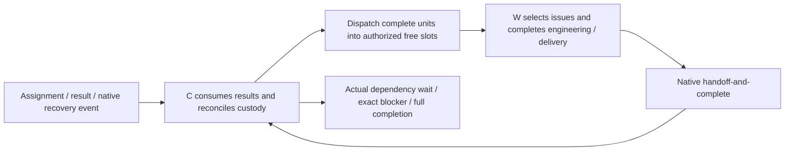

# OpenRig + Pi: a recommended RepoStew deployment

[中文](README.zh.md) · [Repository overview](../../README.md)

Use this shape when OpenRig already owns your agent seats, queue and recovery, and Pi supplies their native tools and sessions. RepoStew supplies the repository workflows and assembled contracts. It is one recommended option alongside the [standalone RepoStew Pi harness](../../harnesses/pi/README.md) and Skill-only use. Choose one execution owner for a task; do not run both queues over the same work.

These templates were distilled from the operator's six-group deployment. They preserve the working configuration structure while replacing personal paths, task identities and authority with explicit placeholders. Copying them does not start agents, grant publication/cleanup permission or resume stopped work. Windows OpenRig operation remains experimental; this directory does not include the local OpenRig core patches.

## Architecture and ownership

| Layer | Responsibility |
| --- | --- |
| RepoStew | Workflow policy, per-seat role/domain contracts, authorized scope and project Markdown records |
| OpenRig | Native identity, queue custody, result handoff/wakes, dependency waiting, Stop and recovery |
| Pi | Native tools, model/session, compaction, cancellation and extension loading |

The coordinator captures/screens inputs, assigns a complete repository unit, consumes results and refills. The worker owns investigation, implementation, target-required tests and authorized direct delivery. **After screening its assigned issue batch, W chooses actionable issues and completes them without returning a candidate list for C to approve.** No-finding, duplicate and already-fixed outcomes remain valid.

Each group keeps its own workers. Cross-source overlap still has one writer per repository. Six result-routing cases describe continuation: delivered; no delivery needed; feasible remainder stays with W; concrete blocker; unknown effects require reconciliation; repeated execution failure needs bounded recovery. C registers reported outcomes and routes factual gaps to the original W; it has no approval or engineering acceptance role.



Pending, starting, active, unknown and unconsumed-result work occupy capacity. Global idle is advisory, not a reservation or process-stop proof. Refill in the result turn while independent feasible work remains. Use native queue create/claim/handoff/block operations with current CLI help, stable IDs and body files. Do not add timers, agent_end self-prompts, shadow task databases or duplicate wakes. Native recovery is not permission to undo an explicit Stop.

## Included templates

| File | Use |
| --- | --- |
| [rig.example.json](rig.example.json) | Minimal 1C+1W OpenRig spec shape, with placeholders for installed agent specs and workspaces |
| [topology.example.json](topology.example.json) | Historical six-group allocation: 16/8/8/8/8/6 W plus six C; planning data, **not OpenRig CLI input** or a recommended starting size |
| [profiles/](profiles/) | Per-agent coordinator/worker `repostew.json` and native Pi settings example |
| [contracts/](contracts/) | Assembled C/W fixed contracts; customize domain and explicit seat binding before activation |
| [task-facts.example.md](task-facts.example.md) | Separate five-field task, exact capture reference, cursor, custody, limits and unknown effects |
| [settings example](profiles/settings.example.json) | Explicitly loads the two independent v0.5.1 modules from `skill/integrations/`; the old example extension entry remains for compatibility only |

The six example domains are new repositories, GitHub feedback, existing GitLab-list work, GitLab feedback, eligible previously completed candidates, and followed-list new issues. Candidate publication is an explicit historical-work domain, not a mandatory gateway for other workers. Models and capacity are operator choices; the recorded Luna/xhigh selection is not a provider availability or throughput guarantee.

## Configure without starting work

1. Select one authorized group and capacity, normally 1C+1W first. Confirm the installed OpenRig/Pi versions, model/effort support, existing credentials and target rules. Inspect current OpenRig spec/CLI help; replace both `agent_ref` placeholders with installed compatible agent specifications. Do not pass unresolved templates to a launch command.
2. Copy the fixed contracts into a private configuration directory. Assemble the applicable domain into each contract and bind the exact seats. Preserve the generic [Skill](../../skill/SKILL.md), target rules, exclusions and conditional security/storage boundaries. Keep new-repository tasks short; feedback/new issues must reference the complete captured batch, window and revision.
3. In each **existing or deliberately chosen Pi agent directory**, merge the relevant profile example as `repostew.json` and merge settings. Replace all `<...>` configuration placeholders with real absolute paths. `workspace` must exist. `seatGuidance` points to the reviewed contract. Copy `coordinator.openrig-pi.json` as `openrig-pi.json`; use its actual loopback URL, rig, observer and exact native seats. `repostew.json` holds only the application contract; W may use application-only mode. Do not overwrite unrelated settings or authentication. Do not copy `auth.json` or session files.
4. Load `pi-repostew.js` and, when needed, `pi-openrig.js`; do not also load `pi-native.js`. Remove the exact old RepoStew `pi.js`/`pi-extras.js` entries if replacing that generation; retain unrelated extensions. Pi must resolve `typebox` through its supported extension environment. The included package does not autoload anything. Keep existing model settings unless explicitly changing them. The example deliberately omits `defaultProjectTrust: always`; add it only when the operator has chosen that native project-trust policy.
5. Configure gh using its existing directory. The Bash `shellCommandPrefix` is an example: preserve existing prefix content and correctly quote the substituted path for your shell. The extension supplies a missing `GH_CONFIG_DIR` for native PowerShell and `pi.exec` as well; existing environment overrides win. No token is read or copied. Add reviewed initial task/facts through the host's supported **initial identity/startup input before work begins**, not a later message racing agent startup.

No installer here mutates a live fleet. In particular, do not run an older configurator over a reviewed profile if it would drop `seatGuidance` or `openrig`. The rig spec intentionally contains no unconditional startup task: restoration must use reconciled current facts, not a stale assignment.

## Activate and verify at a safe boundary

For an authorized fresh seat, use the installed OpenRig lifecycle. For an existing seat, preserve active tools and task custody; wait for a suitable boundary and reconcile unknown writes before replacement. Pi's `/repostew-reload` uses native `ctx.reload()`; it does not prove that every adapter supports same-conversation changes. Fresh launch and native rebuild are different operations.

Check in the **target session**:

- `repostew_runtime_status`: expected v0.5.1, role, native tools and reviewed guidance path. This reports configuration; a path alone is not proof that the intended text was used.
- Inspect the actual prompt/behavior for fixed contract and initial variable facts. For model/thinking changes, inspect persisted Pi session events; an accepted command or saved setting is insufficient.
- `repostew_gh_status`: read-only existing-account verification. Do not log in again merely because an inherited path was absent.
- `openrig_slots` on C: exact roster, active tasks and pending results. It reads a loopback daemon, refuses incomplete queue input, and never reserves, dispatches or certifies stopped processes.
- Run one authorized bounded unit through claim, W engineering/delivery, native result and C refill. Also verify no-action, local blocker, unknown-write and Stop behavior before scaling. Keep local tests, hosted behavior, submission and merge distinct.

Sent, claimed, processed, runtime idle, delivered and whole-campaign complete are distinct. A timeout has unknown delivery until reconciled by effect; do not blindly resend. Keep project `state.md` and short `work/work.md`, not a parallel task database. Fresh C context takes minimal reconciled facts while live W retain custody and accumulated limits.

## Implementation status and upstream boundaries

Validate the template against your installed Pi package without model or network calls:

```sh
rtk node examples/openrig-pi/validate.mjs <installed-pi-package-root>
```

The validator uses a new temporary profile and checks the real Pi loader, fixed contract injection plus current C refill guidance, native prompt preservation, runtime status and profile/rig seat agreement. It does not launch agents or verify a live campaign.

The extension provides prompt-section injection, runtime status, existing-gh verification and a read-only native capacity projection. It introduces no approval gate, tool interception or completion loop. This example ships that extension and reusable templates; it does not replace the existing Skill package's install behavior or change the standalone harness.

Prior local deployment evidence includes native Pi loader/session/prompt checks, representative live tool/gh execution, contract/profile reconciliation and persisted model/thinking events. A 60-seat configuration/activation observation does not demonstrate 60 productive concurrent tasks, sustained throughput, all-seat acceptance or completed campaigns.

Local OpenRig experiments additionally retained Windows `APPDATA` for gh discovery, used host-native PID termination for psmux, and rejected terminal `done + blocked_on`. Those core patches are **not included or claimed upstream-supported**. The queue behavior was separately reproduced on upstream snapshot `39b182e19b009b2ce4c635633915bf2566ad656d` with four focused in-memory tests; that is historical bounded evidence, not validation of every current upstream revision. Blank-shell handover classification, stale telemetry and process clearance retain known limits.

Public upstream context: [startup layers](https://github.com/mvschwarz/openrig/issues/1329#issuecomment-6312986078), [effective configuration](https://github.com/mvschwarz/openrig/issues/1634#issuecomment-6312988178), [topology](https://github.com/mvschwarz/openrig/discussions/1239#discussioncomment-19093949), [Windows experiment](https://github.com/mvschwarz/openrig/pull/1309#issuecomment-6312988975), [Pi capabilities](https://github.com/mvschwarz/openrig/discussions/43#discussioncomment-19093951), [queue semantics #1678](https://github.com/mvschwarz/openrig/issues/1678). [Proposal #11](https://github.com/dajiaohuang/repostew/issues/11) records the original synthesis; this directory is the maintained recommendation/template entry.

Future work: consolidate profile/contract assembly without dropping existing fields, expose effective loaded state, validate supported refresh/replacement boundaries, and retire local host patches only when relevant upstream behavior is verified. Publish reviewed source/templates only, never fleet databases, actual task records, private reports or machine configuration snapshots.

## Current operating contract

The canonical [Skill](../../skill/SKILL.md), [C/W roles](../../skill/roles/coordinator.md) and
[fixed contract plus short facts](../../skill/prompts/fixed-context.md) define the current policy.
C screens, assigns, registers facts and refills; it has no approval or engineering-acceptance role.
W owns the complete six-step unit: understand, repair, target-required tests, direct submission,
submitted/link record, and feasible authorized task-owned cleanup before capacity return.
W completes required terms/CLA/DCO using true established identity and rights facts. No routine CI
lookup/wait or second review follows submission. Private reporting/disposal retains its exact user scope.
OpenRig examples and standalone prompts use this contract; choose one execution owner per task.
The package is 0.5.1; its native Pi extension is 0.5.1. The package and extension now share this release version.


Pi integration now has independent `pi-repostew.js` (application) and `pi-openrig.js` (neutral bridge) modules. Shared `pi-runtime.js` contains mechanisms only. The default loads the application; the bridge is explicit and works independently. Profiles are `repostew.json` and `openrig-pi.json`; `pi-native.js` is the legacy combined entrypoint.
