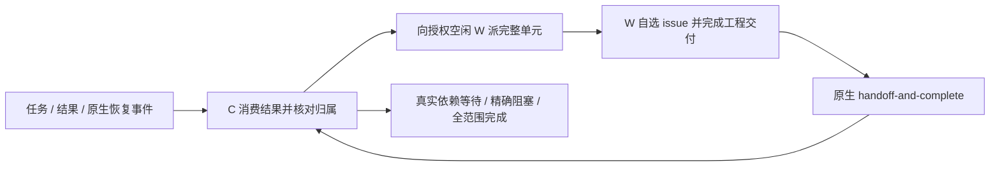

# OpenRig + Pi：RepoStew 推荐运行形态之一

[English](README.md) · [仓库介绍](../../README.zh.md)

当 OpenRig 已负责席位、队列和恢复，Pi 提供原生工具与会话时，可以使用这一形态，由 RepoStew 提供工作流与集成席位契约。它与[独立 RepoStew Pi Harness](../../harnesses/pi/README.zh.md)、单独使用 Skill 并列。同一任务只选一个执行所有者，不让两套队列同时管理相同工作。

模板提炼自实际六组部署，保留有效配置结构，把个人路径、任务身份和授权替换为明确占位符。复制不代表启动、发布/清理授权或恢复暂停工作。Windows OpenRig 仍是实验环境；本目录不包含本地 OpenRig 核心修补。

## 架构与职责

| 层 | 职责 |
| --- | --- |
| RepoStew | 工作方法、逐席位角色/领域契约、授权范围、项目 Markdown 记录 |
| OpenRig | 原生身份、队列归属、结果交接与唤醒、依赖等待、Stop 与恢复 |
| Pi | 原生工具、模型/会话、压缩、取消和扩展加载 |

C 捕获与筛选输入，按仓库派完整单元、收结果并补位。W 负责调查、实现、目标要求的测试和获授权的直接交付。**W 筛完已分配的 issue 批次后自行选择可做的 issue 并完成，不把候选清单交回 C 等批准。** 无发现、重复、已修复仍是有效结果。

每组保留自己的 W；同项目即使来自不同来源也只有一个写者。C 按六类事实路由结果：已交付；无需交付；可行余项留原 W；真实阻塞；未知效果先核对；重复执行故障交有界恢复。C只登记报告事实和协调归属，无审批或工程验收权；事实矛盾交原W说明。



待领取、启动中、进行中、未知状态和未消费结果均占位。全局 idle 仅提示容量，不是预留或进程停止证明。同一结果事件内有独立可行工作就补位。按当前 CLI 帮助使用原生 create/claim/handoff/block、稳定 ID 与正文文件；不另建 timer、agent_end 自提示、影子任务库或重复唤醒。恢复机制不推翻用户 Stop。

## 模板内容

| 文件 | 用途 |
| --- | --- |
| [rig.example.json](rig.example.json) | 1C+1W 最小 OpenRig spec 结构，agent spec 和工作目录待填 |
| [topology.example.json](topology.example.json) | 历史六组 16/8/8/8/8/6 W 加六 C 的容量示例；是规划数据，**不是 OpenRig CLI 输入**，也不是建议起步规模 |
| [profiles/](profiles/) | C/W 的 `repostew.json` 与 Pi 原生 settings 示例 |
| [contracts/](contracts/) | 已集成的 C/W 固定契约；启用前补领域和精确席位绑定 |
| [task-facts.example.md](task-facts.example.md) | 分离的五字段任务、捕获引用、游标、归属、限制与未知效果 |
| [settings示例](profiles/settings.example.json) | 从 `skill/integrations/` 显式加载两个独立v0.5.1模块；旧示例入口仅为兼容 |

六个示例领域分别是新仓库、GitHub 反馈、既有 GitLab 列表未处理仓库、GitLab 反馈、此前已完成合格候选发布、关注列表新增 issue。候选发布组只是明确的历史任务领域，不是所有 W 的中央发布网关。容量和模型由使用者选择；Luna/xhigh 是记录中的配置，不保证当前 provider 可用或吞吐。

## 配置，不自动启动

1. 先选择获授权的组和容量，通常从 1C+1W 开始。核对安装的 OpenRig/Pi 版本、模型与 effort 支持、既有认证和目标规则。读当前 spec/CLI 帮助，将两个 `agent_ref` 替换成已安装兼容 agent spec。未替换模板不能直接 launch。
2. 将固定契约复制到私有配置目录，按领域集成并绑定精确席位。保留通用 [Skill](../../skill/SKILL.md)、目标规则、排除与条件安全/存储边界。新库动态任务可简短；反馈/新增 issue 必须给完整批次、窗口和修订。
3. 在每个**已存在或明确选定的 Pi agent 目录**合并对应 profile 为 `repostew.json`，再合并 settings。把配置中所有 `<...>` 替换为真实绝对路径；`workspace` 必须存在，`seatGuidance` 指向已审阅契约。另将 `coordinator.openrig-pi.json` 合并为 `openrig-pi.json`，填入真实loopback URL、rig、observer和seats；W可只加载业务模块。不覆盖无关配置/认证，不复制 `auth.json` 或会话文件。
4. 加载 `pi-repostew.js` 和按需启用的 `pi-openrig.js`，不再同时加载旧 `pi-native.js`；若替代旧版，精确移除旧 RepoStew `pi.js`/`pi-extras.js` 条目，保留其他扩展。Pi 的支持环境须能解析 `typebox`。本目录 package 不自动加载任何东西。不擅改现有模型。示例刻意不写 `defaultProjectTrust: always`，只有使用者明确选择该项目 trust 策略时才加入。
5. gh 指向既有配置目录。Bash `shellCommandPrefix` 是示例：保留已有 prefix 并对替换路径正确引用；扩展环境也向原生 PowerShell 和 `pi.exec` 提供缺失的 `GH_CONFIG_DIR`，已有环境覆盖优先。不读取或复制 token。将审阅后的初始任务事实放进宿主支持的**初始身份/启动输入，先于工作开始**，不要先开工再补发授权消息。

这里没有修改活动集群的安装器。尤其不能用会丢掉 `seatGuidance`/`openrig` 的旧配置器覆盖已审阅 profile。rig spec 刻意不含无条件启动任务；恢复必须使用核对后的当前事实，不能重放陈旧任务。

## 在安全边界激活与验证

新授权席位使用当前 OpenRig 原生生命周期。已有席位保留活动工具和任务归属，等待适当边界，替换前核对未知写入。`/repostew-reload` 调用 Pi 原生 `ctx.reload()`，不代表所有 adapter 都支持同会话变更。fresh launch 与 native rebuild 是不同操作。

必须在**目标会话**检查：

- `repostew_runtime_status`：v0.5.1、角色、原生工具、契约路径符合预期；路径显示只证明配置，不证明该文本已被使用。
- 实际 prompt/行为包含固定契约和初始可变事实；改模型/thinking 后检查持久会话事件，不能只看保存配置或命令接受。
- `repostew_gh_status`：只读验证既有登录；不能因继承路径缺失就重新登录。
- C 的 `openrig_slots`：精确 roster、活动任务、待收结果；只读 loopback daemon，拒绝不完整队列输入，不预留、派发或证明进程停止。
- 一个获授权完整单元走完领取、W 工程/交付、原生结果和 C 补位；扩容前再覆盖无需交付、局部阻塞、未知写入与 Stop。区分本地测试、宿主行为、提交与合并。

已发送、已领取、已处理、运行时 idle、已交付、全 campaign 完成是不同事实。timeout 先核对效果，不盲重发。项目保留 `state.md` 和短 `work/work.md`，不另建任务数据库。新 C 只接最小已核事实，活动 W 保留归属与累计限制。

## 实现状态与上游边界

可针对已安装的 Pi 包验证模板，不调用模型或网络：

```sh
rtk node examples/openrig-pi/validate.mjs <installed-pi-package-root>
```

验证器使用新的临时 profile，检查真实 Pi loader、固定合同与C续派规则注入、原生 prompt 保留、运行信息和 profile/rig 席位对应；不启动智能体，也不证明活动 campaign 已通过验收。

扩展提供 prompt section 注入、运行信息、既有 gh 验证、原生容量只读投影；不增加审批门槛、工具拦截或完成循环。本目录发布此扩展及可复用模板，不改变现有 Skill 包安装行为或独立 Harness。

此前本地部署证据包括 Pi 原生 loader/session/prompt 检查、代表席位实际工具/gh 执行、契约/profile 核对、模型/thinking 会话事件。60 席配置/激活观察不证明 60 个同时有效工程任务、持续吞吐、全席行为验收或全部 campaign 完成。

本地 OpenRig 实验还包括 Windows 子进程保留 `APPDATA`、psmux 使用宿主原生 PID 停止、拒绝终态 `done + blocked_on`。这些核心修补**不随模板发布，也不宣称上游已支持**。队列行为曾在上游快照 `39b182e19b009b2ce4c635633915bf2566ad656d` 以四项内存数据库聚焦测试复现；这是历史有界证据，不是对所有当前上游版本的验证。blank-shell handover 分类、陈旧活动遥测和进程归属判定仍有限制。

公开上游背景：[启动分层](https://github.com/mvschwarz/openrig/issues/1329#issuecomment-6312986078)、[有效配置](https://github.com/mvschwarz/openrig/issues/1634#issuecomment-6312988178)、[拓扑](https://github.com/mvschwarz/openrig/discussions/1239#discussioncomment-19093949)、[Windows 实验](https://github.com/mvschwarz/openrig/pull/1309#issuecomment-6312988975)、[Pi 能力](https://github.com/mvschwarz/openrig/discussions/43#discussioncomment-19093951)、[队列语义 #1678](https://github.com/mvschwarz/openrig/issues/1678)。[提案 #11](https://github.com/dajiaohuang/repostew/issues/11)保留初始整合记录，本目录是持续维护的推荐形态/模板入口。

后续收敛：统一不丢既有字段的 profile/契约装配、暴露实际加载状态、验证刷新/替换边界、按对应上游实际行为逐个退掉本地补丁。只发布审阅后的源码和模板，不发布集群数据库、真实任务记录、私密报告或机器配置快照。

## 当前统一口径

以[Skill](../../skill/SKILL.md)、[C/W职责](../../skill/roles/coordinator.md)和[固定合同＋短事实](../../skill/prompts/fixed-context.md)为当前规则。
C只筛选、分派、登记和续派，无审批或工程验收权。W独立完成理解、修复、目标要求的测试、直接投稿、投稿链接登记、可行任务内清理六步后交回容量。
W依据真实身份和权利事实自主完成所需条款、CLA/DCO；投稿后不例行查等CI、不加二次验收。私密发送／处置仅按用户明确范围执行。
OpenRig示例与独立执行器提示词采用同一合同；每项任务只选一个执行owner。包版本0.5.1，原生Pi扩展版本0.5.1，本次统一为同一发布版本。


Pi扩展现分为 `pi-repostew.js`（RepoStew业务）和 `pi-openrig.js`（中立OpenRig桥接）；共享 `pi-runtime.js` 仅提供通用机制。默认只加载业务模块，桥接可单独或组合使用。配置分别在 `repostew.json` 与 `openrig-pi.json`；旧 `pi-native.js` 仅保留兼容。
